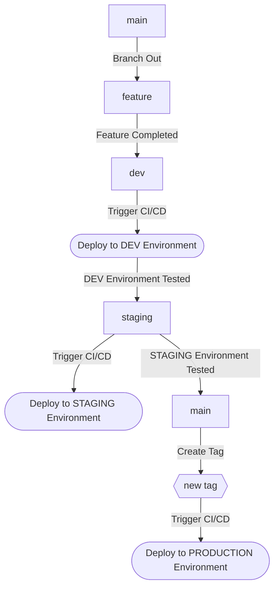

## Template

Replace all instances of `python-template` with the name of your code repository.

To avoid port clashes when running multiple services locally, pick a unique pair of ports for this service before starting:

- Replace all instances of `4000` with a unique `4xxx` port for the app.
- Replace all instances of `15000` with a unique `15xxx` port for the database.

## Naming Convention

`module_name`, `package_name`, `ClassName`, `ExceptionName`, `GLOBAL_CONSTANT_NAME`, `function_name`, `global_var_name`, `instance_var_name`, `function_parameter_name`, `local_var_name`.

## Development

**Prerequisites**

- [uv](https://github.com/astral-sh/uv)
- Docker

**Install pre-commit hook**

```bash
uv run python .pre-commit/setup.py
```

**Start development environment**

- Create a `.env` file.
  - Refer to `.env.example` for the required environment variables.

- Install dependencies

```bash
uv sync
```

- Start the app server and database in Docker

```bash
docker compose up -d
```

- View consolidated logs via Docker Compose

```bash
docker compose logs -f
```

- Shutdown app server and database

```bash
docker compose down
```

## Local URLs

**Python app**

```text
http://localhost:4000/
```

**API reference**

```text
http://localhost:4000/docs
```

**Postgres database port**

```text
15000
```

## Database Migration

**Prerequisites**

- [uv](https://github.com/astral-sh/uv)
- Docker

**Start development environment**

- Start the development environment in Docker

```bash
docker compose up -d
```

**Update database schema**

- Generate migration

```bash
uv run poe migration-generate
```

- Apply migration

```bash
uv run poe migration-run
```

## Managing Dependencies

**Add a runtime dependency**

```bash
uv add <dependency-name>
```

**Add a development dependency**

```bash
uv add --group dev <dependency-name>
```

**Remove a runtime dependency**

```bash
uv remove <dependency-name>
```

**Remove a development dependency**

```bash
uv remove --group dev <dependency-name>
```

**Update dependencies**

```bash
uv lock --upgrade
uv sync
```

**Restart the app after changing dependencies**

After adding, removing, or upgrading dependencies, restart the app container.

```bash
docker compose restart app
```

## Auto-Format Code

```bash
uv run ruff format .
```

## Git Branching Guidelines


